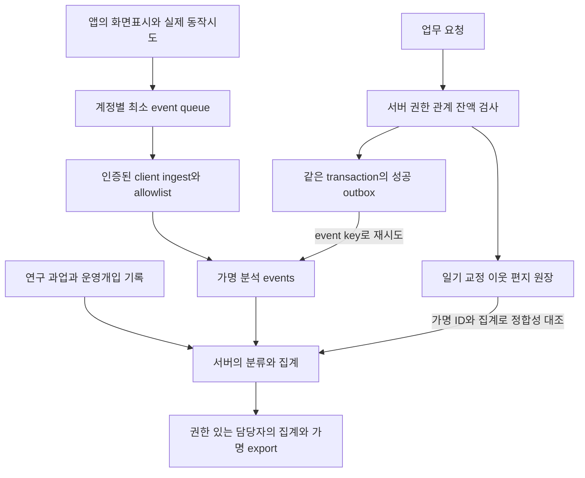

# 분석 데이터 수집 설계

상태: **설계 완료 / 수집 코드·DB·대시보드·실제 데이터 없음**. 사용자는 이번 후속 답변에서 “수집 설계를 문서에 반영”을 선택했다. 앱 코드·의존성·서버·운영 설정은 바꾸지 않았다. 아래 자원/함수명·기술 한도·운영 절차는 후속 구현 제안이다.

## 1. 무엇을 판단하기 위한 수집인가

확정된 제품 정책은 이웃신청과 수락을 거치는 상호친구, 모든 사용자 간 편지, 친구 발송 무료·비친구 발송 1토큰, 하루 1토큰 지급·교정 1토큰 보상이다. iPhone을 기본 지원하고 iPad 필기는 추가로 확인한다. 이번 테스트에는 결제를 넣지 않는다. 비공개 전환 뒤에도 기존 결과를 보관할 수 있으며 삭제는 사용자 선택이다. 가입은 기본정보 → 프로필 → 온보딩 순서이고 복수 학습언어와 언어별 상중하를 받는다.

수집 목적은 다시 기록하는지, 같은 상대와 교류를 이어가는지, 교정을 읽고 복습하는지 확인하는 것이다. 비친구 편지 비용, 언어별 교정 공급, 기기와 버그가 사용을 막는지도 함께 본다. 성공 판정 수치는 아직 미정이다. 측정 정의와 분모를 먼저 정하고 본 테스트 전에 D17에서 기준을 합의한다.

분석 이벤트에는 행동과 상태, 집계에 필요한 원장 수량을 기록한다. 일기·편지 원문이나 가입 프로필 전체를 복제하지 않는다. 현재 stamp_transactions만으로는 가입 이탈, 자발 사용, 이웃·편지의 반복 교류를 분석할 수 없다.

## 2. 최소 수집 구조와 신뢰 경계 — 제안

현재 Supabase 기반에 제한된 이벤트 ingest와 업무 transaction의 outbox를 추가하는 안이다. 외부 분석 SDK 도입은 이 설계의 전제조건이 아니다. 실제 자원은 아직 없다.



클라이언트는 버튼 클릭, 로딩 시간, 화면 표시를 관찰한다. 실제 편지 발송, 교정 완료, 우표 지급·차감, 관계 상태는 서버가 확정한다. 업무 데이터와 성공 사건을 보내기 위한 outbox를 같은 transaction에 저장한다. outbox는 분석 저장소가 일시적으로 실패해도 사건을 나중에 전달하도록 보관하는 목록이다.

분석 조회나 전달 장애 때문에 이미 저장된 편지를 실패로 표시하지 않는다. 별도 전달 작업이 동일한 사건 키로 재시도하고 분석 저장소가 중복을 제거한다. 업무 저장과 outbox 기록의 경계는 후속 구현에서 검증해야 한다.

## 3. 제안 데이터 사전

| 자원 | 최소 필드·제약 | 쓰기·조회 권한 |
|---|---|---|
| analytics_participants | participant_id 가명 UUID PK, auth_user_id(비공개 연결), study_id, unique(study_id,auth_user_id), enrollment_at, collection_state, notice_version, cohort_code, eligible_device_class, 최소 language_snapshot | 서비스/승인된 연구 등록만 변경. auth_user_id 매핑은 앱/일반 export에 반환하지 않음 |
| analytics_events | event_id UUID, producer client/server, participant_id, study_id, event_name/schema_version, session_id?, occurred_at_utc, received_at_utc, build_id, device_class?, action_ref?, typed_properties | client 직접 테이블 INSERT/SELECT 금지. 제한 RPC 또는 서버 outbox만 기록. unique(study_id,producer,participant_id,event_id), 중복 다른 payload는 충돌 |
| analytics_outbox | deterministic business_event_key unique, 최소 payload, occurred_at, delivery_state, attempts, next_retry_at, delivered_at | 서비스 전용. 업무 실행과 같은 transaction; delivery 성공 후 재시도 중복 제거. 장기 미전송 건수 확인 |
| study_assignments | assignment_id, participant_id, task_code, active_from/to, required/free_period, schedule_version | 연구 담당만 배정/수정, 변경 이력 남김. 클라이언트에서 required를 voluntary로 조작할 수 없음 |
| study_interventions | intervention_id, participant/pair ref, type=hint/reminder/operator_correction/support 등, occurred_at, 적용과업/기간, operator_ref | 연구 담당만 입력. 기본 정형 코드, 별도 동의 없는 개인 본문 자유 메모 금지 |
| study_analysis_annotations | event/session/pair 범위, context=required/free/unknown, assistance=none/hint/reminder/seed/unknown, evidence_ref, reviewed_at/by | 근거 있는 분류/정정. null intervention을 곧바로 자발로 해석하지 않음 |
| 집계 view/export | 일자·언어·출처·기기·관계별 수, 고유 참여자/쌍 분모, source coverage/분류 미정 수 | 승인된 분석 담당만. 앱 사용자/다른 참가자에게 공개하지 않음. 매핑·본문 join 제외 |

위 이름은 설계용이다. 일반 앱 사용자가 service_role 키를 가져야 하는 구조로 구현하지 않는다. 분석 담당 allowlist는 서비스가 관리하고 권한 변경 로그를 남기는 안이다. 가명 ID도 같은 사용자를 연결할 수 있는 데이터이므로 익명정보라고 부르지 않는다.

언어 snapshot은 연구 시작 시점 또는 사건 당시 승인된 언어 코드/수준을 제한적으로 저장한다. 프로필이 바뀌어 과거 집단이 조용히 바뀌지 않게 버전을 둔다. 실제 국적·출생연도·성별·위치 원값은 기본 이벤트에서 제외하고, 꼭 필요한 집단이 나중에 정해지면 목적/안내/노출 범위를 먼저 정한다. 출생연도 기반 연령대도 자동 추가하지 않는다. 상대가 연구에 참여하지 않았거나 수집을 철회했다면 상대 개인 참조를 분석 데이터로 새로 만들지 않고 target_in_study=false 등 집계용 상태만 남기는 안이다. 전체 사용자 간 편지 발송 기능은 그대로 제공한다. 반복 pair 분석은 양측이 연구 수집 대상인 경우로 한정하고 해당 범위와 누락 수를 보고한다.

## 4. 공통 필드·수집 계약 — 신규 제안

- `event_id`: UUID. 최초 생성 후 응답 유실과 재전송에도 유지한다. 서버 사건은 업무 동작과 사건 종류의 조합에 고유키를 둔다.
- `event_name`, `schema_version`: 등록된 이름과 버전만 받는다. `properties`는 이벤트별 필드·타입·열거값을 검사하며 임의 JSON 객체는 받지 않는다.
- `participant_id`, `actor_role`, `study_id`: 서버가 JWT와 연구 등록 정보로 결정한다. 클라이언트가 운영진 역할이나 다른 참여자를 지정할 수 없다.
- `session_id`: 계정별 foreground 세션. 초기 제안은 background 30분 이후 새 세션, 계정 변경 시 즉시 새 세션이다. 광고 ID나 기기 지문은 사용하지 않는다.
- `occurred_at_utc`, `received_at_utc`: 발생 시각과 서버 수신 시각을 구분한다. 서버 사건은 서버 시각을 사용한다. 큰 시차나 미래 시각은 표시하며 클라이언트 시계로 일일 토큰 지급일을 결정하지 않는다.
- `writing_language`, `source`, `input_mode`: 해당 revision의 언어, ai/human 출처, text/handwriting/mixed 모드를 정형값으로 기록한다. 프로필에 여러 학습언어가 있어도 사건의 대상 언어를 식별할 수 있어야 한다.
- `object_ref`, `pair_ref`, `action_ref`: 분석용 가명 참조다. 실제 객체와 연결하는 매핑은 제한된 영역에 두고 파일 URL이나 Storage 경로를 보내지 않는다. pair는 순서와 무관한 키를 쓰고 발송 방향을 별도로 둔다.
- `task_context`, `assistance`: 과업과 운영 개입 기록에 근거해 분류한다. 클라이언트가 제시한 assignment_ref도 실제 배정과 기간을 서버가 검사한다. 근거가 부족하면 unknown으로 둔다.
- `error_code`: 정해진 코드만 기록한다. 임의 error.message, SQL details, URL·headers, stack, 로컬 파일명은 수집하지 않는다. duration_ms도 범위를 검사한다.

제안 전송 함수는 인증 RPC `ingest_product_events`이며 현재 존재하지 않는다. 입력은 `batch_id`와 최대 50개 `events[{event_id,event_name,schema_version,session_id,occurred_at_utc,properties}]`다. 초기 기술 한도는 배치 64KiB, 사건별 properties 2KiB를 제안하며 실제 기기 측정 후 조정한다.

성공 응답에는 accepted_ids, duplicate_ids, rejected[{event_id,reason_code}], server_received_at를 포함한다. 각 사건을 검사해 수락·중복 확인된 것만 큐에서 제거한다. unknown_name, invalid_schema, forbidden_field, not_enrolled, not_authorized, invalid_reference, id_conflict 등 정형 오류를 반환한다. 같은 ID와 다른 내용을 보내면 덮어쓰지 않는다. 중복키는 study·producer·participant 범위를 포함해 다른 계정의 사건과 섞이지 않게 한다.

401이면 전송을 멈추고 같은 계정의 세션 갱신·재인증 후 재시도한다. 계정이 바뀌거나 로그아웃·수집 철회가 확인되면 이전 계정 큐를 새 계정으로 보내지 않고 정리한다. 429·네트워크·5xx는 지수 backoff와 임의 지연으로 동일 ID를 재전송한다. 영구 스키마 오류는 반복 전송하지 않고 원문 없는 오류 건수로 추적한다.

클라이언트는 server-only 사건을 제출할 수 없다. 결과나 편지를 열었다는 사건도 대상 접근권한과 열람자 역할을 검사한다. 다만 클라이언트의 실제 표시 보고는 서버의 업무 커밋만큼 강한 증거가 아니므로 같은 신뢰도로 합치지 않는다.

서버 성공은 outbox 전달 작업이 기록한다. 업무행·원장·outbox·분석 사건을 대조해 누락과 스키마 오류를 찾는다. 실제 함수명, 테이블명, 실행 주기는 후속 구현에서 확정한다.

## 5. 이벤트 사전

아래는 후속 구현 대상이다. 현재 존재하지 않는 관계/편지/교본에 event만 붙여 구현 완료로 보지 않는다. group으로 적은 이름은 각 실제 enum으로 분리한다.

| event_name | 누가 확정하나 | 정확한 발생 시점 | 허용 속성 예 | 해석/주의 | 연결 |
|---|---|---|---|---|---|
| study_session_started / ended | 클라이언트+서버 session 검증 | 연구참여 로그인계정 foreground 세션 시작/종료. 종료유실은 timeout 처리 | session_id, device_class, os_major, build_id, duration_ms? | 재방문/기기 차이. background fetch를 방문으로 세지 않음 | F25 F26 / V25 V27 |
| signup_step_viewed / validation_failed | 클라이언트 | 가입1·프로필2 페이지가 보임/허용된 오류 표시 | step=basic/profile, field_code, error_code; 입력값 제외 | 가입 단계 이탈·필수항목 장애 | F01 F02 / V02 |
| signup_step_completed / signup_completed | 서버 | 각 단계 저장/필수정보·프로필 저장 성공 transaction | step, learning_language_count, schema_version | 가입 완료율. onboarding_completed와 별개 | F01 F02 / V02 |
| onboarding_completed / skipped | 서버 저장 | 안내 완료/건너뛰기 상태 저장 후 | onboarding_version, outcome | 안내노출과 실제활동 구분; skip은 제공하기로 정한 경우 | F03 / V02 |
| diary_editor_opened | 클라이언트 | 빈 편집 또는 기존초안 렌더링 완료 | entry_point, draft_restored, input_mode, writing_language | 작성진입→저장. 자판누름/본문 수집 없음 | F05 F07 / V05 |
| draft_restore_succeeded / failed | 클라이언트 | 초안읽기 및 화면복원 결과 | input_mode, attachment_count, error_code? | 복구 실패와 쓰기수요 부족 구분 | F07 / V05 V24 |
| diary_save_attempted / failed | 클라이언트 | 실제 저장명령 발행/실패 처리 | attempt_id, operation_ref, mode, writing_language, attachment_count, error_code, duration_ms | 시도/실패. 서버 성공을 대신하지 않음 | F05 F06 / V06 V24 |
| diary_revision_saved | 서버 | 원문 revision 저장 transaction 커밋 | revision_ref, operation_ref, mode, writing_language, revision_no | 텍스트/필기 원문 저장. 첨부까지 완료와 구분 | F05 F08 / V05 V07 |
| diary_ready | 서버 | 모든 필수첨부·manifest가 준비된 동일 revision의 상태전이 | revision_ref, input_mode, writing_language, attachment_count | 수요지표의 작성완료. text-only도 준비상태 전이1회 | F05 F06 F08 / V06 |
| media_upload_failed / recovered | 클라이언트 관찰+서버완료 구분 | 업로드 실패/재시도 뒤 준비완료 확인 | revision_ref, media_kind, error_code?, retry_bucket, duration_ms | 사진/필기 유실·복구. URI/경로/이미지 제외 | F06 F08 / V06 V07 |
| diary_visibility_changed | 서버 | 공개상태 변경 transaction | diary_ref, from/to=public/private | 비공개변경을 삭제로 세지 않음 | F09 F14 / V09 |
| correction_requested | 서버 | AI job 또는 사람 request 접수 커밋 | request_ref, revision_ref, source=ai/human, writing_language, operation_ref | 공급/대기 분모. 둘 다 선택이면 source별2사건 | F09 F11 / V08 V11 |
| human_claim_changed | 서버 | claim/반납/회수 상태전이 | request_ref, action=claimed/released/expired, language | 선점정체와 교정공급 구분 | F10 / V12 |
| correction_completed / failed | 서버 | 결과 저장/실패 job 기록 transaction | request_ref, result_ref?, source, error_code?, latency_ms, retry_attempt | 출처별 성공/실패·품질평가 대상을 식별 | F10 F11 / V11 V12 |
| correction_result_viewed | 클라이언트 요청, 서버 대상접근 검증 | 해당 출처 결과가 실제 표시된 후 | result_ref, source, session_id | 결과 열람. 실제 이해/학습향상을 뜻하지 않음 | F13 / V14 |
| final_version_saved | 서버 | 출처선택 최종본 저장 | revision_ref, final_ref, source_mix | 교정채택 단서. 수정된문장/선택본문 제외 | F13 / V14 |
| review_card_saved / deleted | 서버 | 사용자가 카드 저장/삭제 커밋 | card_ref, source, revision_ref | 유용한 피드백 저장·삭제. 비공개전환 자동 삭제 없음 | F15 / V15 |
| review_card_viewed | 클라이언트 요청, 서버 권한검증 | 카드내용 표시 후 | card_ref, source, entry_point=home/archive | 다른 날 복습률. 페이지 열기만으로 카드열람 추정 금지 | F15 / V15 |
| explore_viewed / empty | 클라이언트 | query 결과 렌더링, 빈 결과 | filter_languages, friends_only, result_count_bucket, duration_ms | 언어별 공급과 탐색 막힘 | F12 / V13 |
| public_profile_viewed | 클라이언트 요청, 서버 대상검증 | 공개 프로필 렌더링 | target_participant_ref, entry_point | 새 접점. 실제 handle/닉네임 제외 | F16 / V03 |
| neighbor_request_created / resolved | 서버 | 이웃 신청/수락/거절/철회 커밋 | pair_ref, request_ref, action, requester_ref, recipient_ref | 상호이웃 전환. follow event 없음 | F17 / V16 |
| neighbor_removed | 서버 | 상호친구 해제 커밋 | pair_ref, action | 해제 뒤 비용/반복교류 해석 | F17 / V16 |
| letter_send_attempted / failed | 클라이언트 | 편지 전송명령 발행/오류 표시 | attempt_id, operation_ref, entry_point, error_code, duration_ms | 비친구 토큰 부족·기술실패. client relation/cost는 분석 확정값으로 받지 않음 | F18 F21 / V18 |
| letter_sent | 서버 | 편지저장·토큰원장과 같은 transaction | letter_ref, pair_ref, direction, reply_to_ref?, relation_at_send=friend/nonfriend, token_cost=0/1, operation_ref | 실제 발송·답장·친구별 비용. 재전송은 같은 사건 | F18 F21 / V10 V18 |
| letter_opened | 클라이언트 렌더 확인 후 서버 읽음 저장 | 발신/수신자 구분, 해당 편지가 실제 열린 뒤 | letter_ref, viewer_role=sender/recipient, session_id | 수신자 열람률·열람까지 시간. 받은편지 목록조회로 대체 금지 | F18 / V18 |
| token_transaction_recorded | 서버 | 원장 생성 transaction | ledger_ref, action_ref, event_kind, delta, balance_after, policy_day, policy_version | +1일일/+1교정/-1비친구 편지. 결제아님, 잔액/원장 대조 | F21 / V10 |
| interaction_rejected | 서버 검증경로 | 관계/편지/교정 business 거부 확정 | action_type, operation_ref?, reason_code=blocked/insufficient_tokens/invalid_state/not_allowed | 서버실패와 client표시를 별도로 보고 같은 실패를 합산하지 않음 | F17 F18 F20 / V18 V19 |
| like_set / comment_created / comment_deleted | 서버 | 좋아요 목표상태·댓글 생성삭제 커밋 | target_ref, liked?, action | 단순반응을 편지 왕복과 구분, 댓글원문 제외 | F19 / V17 |
| block_changed / report_created | 서버 | 차단/해제/신고접수 커밋 | action, target_type, reason_code(정형)만 | 운영 문제 추이. 대상가명/상세는 제한된 운영조회, 일반 분석export 제외 | F20 / V19 V28 |
| notification_opened / permission_outcome | 클라이언트 요청+대상검증 | 알림 선택/권한 결과 | event_type, channel, permission_type, outcome | 도달/기기 거절. push전달=읽음으로 세지 않음 | F23 F24 / V20 V21 |
| record_deleted / account_deletion_state | 서버 | 명시적 삭제/탈퇴작업 상태전이 | resource_type, stage, outcome, error_code; 본문/연락처 제외 | 비공개와 삭제 구분·삭제복구. 연구철회 뒤 개인분석event 보존 정책 별도 | F14 F24 / V22 |
| performance_observed | 클라이언트 | 정의된 화면/동작 측정 종료 | scenario_code, duration_ms, failure_code?, device_class, network_class(정형), build_id | p50/p95·실패분포. 전체 URL/원문/임의 exception.message 제외 | F25 / V25 |

`letter_sent`의 reply_to_ref가 있으면 답장으로 집계한다. 별도 letter_replied 성공 사건을 또만들어 발송수를두 번 세지 않는다. 토큰과 업무 성공은 서로다른 분석사건이지만 `action_ref`로 연결해 차감1건/편지1건임을 대조한다. 단순좋아요·결과 조회·편지 왕복은 같은종류의 관계활동으로합치지않는다.

## 6. 편지·원장·보존 정합성

서버는 operation_id로 기존 발송 결과가 있는지 먼저 확인한다. 새 요청에만 친구 여부, 차단, 잔액을 검사한다. 이웃 수락·해제와 편지 발송이 겹쳐도 한 시점의 관계와 비용을 기록하도록 잠금 순서를 정한다. 친구 비용은 0, 비친구 비용은 1이다. 편지와 발송 시 관계·비용, 차감이 있는 경우 원장, 성공 outbox를 함께 커밋한다.

같은 operation_id와 다른 내용은 충돌로 거부한다. 중복 확인을 위한 내용 비교값을 분석 이벤트에 내보내지는 않는다. 관계가 수락된 뒤 이전 발송을 재시도해도 최초 발송의 비용을 다시 계산하지 않고 원래 결과를 돌려준다. 새로운 편지는 새 operation_id로 그 시점의 관계를 확인한다.

편지 저장 뒤 푸시가 실패했다고 발송 실패로 표시하거나 자동 환급하지 않는다. 수신자가 실제로 편지를 열었는지는 별도 letter_opened 사건이다. 무료 편지도 성공과 비용 0을 기록하되 금액 0인 우표 원장 행을 억지로 만들 필요는 없다.

일일 지급량은 +1로 확정됐다. 다만 policy_day의 시간대, 접속 조건, 미접속일 처리와 누적 상한은 아직 미정이다. 구현 전에 정하고 policy_version을 남긴다. 분석 집계 시간대와 토큰 지급 시간대가 같다고 임의로 가정하지 않는다.

비공개 전환은 diary_visibility_changed이며 record_deleted가 아니다. 기존 교정·편지·복습 카드의 보존과 원문 접근권한을 분리한다. 사용자 직접 삭제, 연구 수집 철회, 계정 탈퇴도 서로 다른 사건이다. 분석 원시 사건의 삭제·가명 연결 정리 기준은 서비스 기록 보관 선택과 별도로 정한다.

## 7. 기기 큐·개인정보·운영

연구 참여 안내, 수집 범위·기간, 보관과 철회 방식을 정한 뒤 수집을 활성화한다. 구체적인 안내 방식은 D17의 후속 결정이며 이 문서에서 법적 동의 요건을 판정한 것은 아니다. 분석 수집이 비활성 상태여도 서비스의 일기·편지·우표 원장은 동작하도록 분리한다.

기기 큐의 초기 제안은 계정별 최대 500건, 72시간 TTL, 한 번에 50건 전송, 재시도 간격 상한 5분이다. 후속 구현에서 측정해 조정할 기술 기본값이다. 로그아웃과 계정 전환에서 A의 큐를 B의 JWT로 전송하지 않는다. 연구 철회 때는 큐와 재시도 작업을 정리한다. 강제 종료 뒤 복원, 제한된 백그라운드 전송, 용량 초과 시 낮은 우선순위 사건 제거와 drop_count 기록을 검증한다. 서버 성공 사건은 기기 큐의 유실에 의존하지 않는다.

자동 수집에서 제외할 정보는 일기·편지·교정·댓글 본문, 입력 초안, 사진·획·음성, 닉네임·아이디·이메일, 출생연도 원값·성별·위치 원값, 파일 URI·URL, JWT·키, 임의 로그·stack, clipboard, 세션 리플레이다. `token_cost`는 우표 수량이며 인증 토큰과 다르다. 인프라의 기본 IP·헤더 로그는 별도 설정 점검 대상으로 남긴다.

보관은 연구와 보고서에 필요한 최소 기간으로 제한하는 안을 제안한다. 구체 기간, 조회 담당, 철회·탈퇴 시 정리 범위는 D14·D17에서 확정해야 한다. 구현자는 만료 설정, 삭제 작업, 접근 로그, 내보내기 제한을 만들고 A06·A09에서 확인한다. 참여자와 실제 계정을 연결하는 표는 분석 내보내기와 분리한다.

현재 제안한 인증형 수집만으로 로그인 전 설치나 인증 실패를 완전하게 집계할 수는 없다. 모집·설치 성공과 실패는 가명 참가코드의 운영 관찰표로 따로 기록한다. 익명 로그인 전 추적이 필요하면 별도 설계하며, 수집되지 않은 값을 0으로 취급하지 않는다. 로그인 전 사건을 임의로 다음 계정에 연결하지 않는다.

## 8. 집계 정의와 내보내기

| 지표 | 사건·조건 | 분모·계산 | 해석 주의 |
|---|---|---|---|
| 가입 퍼널 | 기본정보 노출→저장→프로필 노출→가입 완료→온보딩 완료/건너뛰기 | 단계별 고유 참여자/직전 단계 도달자. 모집·로그인 실패는 별도 | 누락된 최초 노출은 0이 아니다 |
| 자발 재기록 | 첫 의무 작성 이후 다른 연구일의 diary_ready | 추가 관찰 기회가 있는 첫 작성자 중 추가 작성자 비율 | 의무·개입·unknown과 버그 중단을 따로 표시 |
| 같은 상대 반복 왕복 | A→B와 B→A 발송의 왕복 후 같은 pair의 추가 왕복 | 첫 왕복 뒤 관찰 가능한 pair 중 반복한 pair와 사용자 수 | 연속 발송을 여러 왕복으로 세지 않으며 의무·자발을 분리 |
| 새 접점→상호이웃 | 비친구 편지/프로필 열람→이웃신청→수락 | 새 접점이 있는 고유 pair 중 수락 pair. 진입 경로별 분리 | 행동 순서가 인과관계의 증거는 아님 |
| 편지 열람·답장 | letter_sent→수신자 opened→reply_to가 있는 발송 | 편지·수신자·pair 분모를 구분하고 관찰 기간 내 시간과 비율 집계 | 발신자 열람·목록 조회는 제외. 발송 당시 관계 기준 |
| 토큰 사용·막힘 | 원장과 서버 잔액부족 거부 | 지급·보상·사용 합, 친구/비친구 발송 수, 비친구 시도 중 잔액부족 비율 | 교정 요청 비용은 미확정. 결제 전환율은 없음 |
| 교정 공급·품질 | 요청→선점→완료/실패→열람, 언어·출처별 | 요청 수, 교정 가능한 참여자, 미완료와 대기시간 분포 | 운영진 공급 별도. 완료율로 품질·학습 향상을 단정하지 않음 |
| 피드백 활용 | 결과 열람→카드 저장→다른 날 재열람 / 최종본 저장 | 결과 수신자 중 각 단계 도달자, AI/사람/필기 구분 | 저장 클릭은 이해나 표현 개선의 증거가 아님 |
| 필기 가치 | 필기 작성완료·복원·교정, 지원 기기별 | 실제 지원 기기·펜 보유 시험참여자 중 선택·완료·재사용 | H0 통과 전 미지원. 전체 모집자를 분모로 잡지 않음 |
| 안정성·수집 품질 | 시도·실패·복구·성능과 업무행/outbox 대조 | 시나리오별 오류율·p50/p95, 누락·지연·드롭 수 | 느린 기기와 실패를 제외한 평균만 보고하지 않음 |

연구일자는 study_timezone으로 고정하고 원본 시각은 UTC를 유지한다. Asia/Seoul은 초기 제안이며 사용자 확정값은 아니다. 지연 도착 사건에는 표시를 두고 재집계 시점을 기록한다. 7일 관찰 기회가 없는 참여자를 7일 재방문 분모에 넣지 않는다. 철회·삭제로 분모가 바뀌면 집계 버전과 제외 기준을 남긴다.

운영 개입 기록이 없다는 이유만으로 자발 사용으로 확정하지 않는다. 필수 과업 밖의 관찰 구간에서 관련 힌트·독려·운영진 활동이 없었는지 대조한다. 근거가 없으면 unknown으로 보고한다. 교정 공급을 운영진이 보충한 경우 일반 참여자와 분리한다.

최소 결과표는 참가자 퍼널, 언어·출처별 교정 공급, 친구·비친구 편지와 반복 pair, 원장과 잔액부족, 복습, 기기·버그·수집 품질이다. 집계 CSV와 가명 사건 CSV를 구분하고 허용 열만 내보낸다. 실제 계정 매핑, 원문, 파일 URL, 운영진 자유 메모는 자동으로 합치지 않는다. 이번에는 실제 CSV나 대시보드를 생성하지 않았다.

서버 내부 사건의 필드 예시(합성값):

```json
{
  "event_id": "00000000-0000-4000-8000-000000000001",
  "producer": "server",
  "event_name": "letter_sent",
  "schema_version": 1,
  "participant_id": "00000000-0000-4000-8000-000000000002",
  "action_ref": "synthetic_action_1",
  "properties": {
    "letter_ref": "synthetic_letter_1",
    "pair_ref": "synthetic_pair_1",
    "direction": "a_to_b",
    "relation_at_send": "nonfriend",
    "token_cost": 1
  }
}
```

실제 데이터가 아닌 필드 예시이며 전체 필수 필드 중 서버 시각·study 등은 생략했다. 클라이언트가 이 server 사건을 ingest에 보내면 거절해야 한다.

## 9. 수집 품질의 완료 기준 — 전부 미실행

| ID | 검사 조건 | 기대 결과 | 연결 |
|---|---|---|---|
| A01 | 가입 두 단계·복수언어 | 가입과 온보딩 완료를 분리. handle·출생연도·소개 원문이 이벤트에 없음 | V02 V03 V23 |
| A02 | 성공·신원 위조 | client의 server 사건·금액·운영진 역할 지정 거절. JWT로 참여자 결정 | V10 V18 V23 V27 |
| A03 | 배치·업무 응답 유실 | 같은 ID 1건. 편지·차감·성공 사건 각각 1건. 다른 내용 재사용은 충돌 | V10 V18 V27 |
| A04 | 원문 저장 뒤 사진 실패 | revision_saved는 1건, ready는 0건. 복구 후 ready 1건 | V06 V24 V27 |
| A05 | 친구 여부·발송 경합 | 서버 관계와 비용 0/1, 원장 일치. 친구 잔액0 성공, 비친구 잔액0 실패 | V10 V16 V18 |
| A06 | 계정 전환·철회·오프라인 | A 큐를 B JWT로 전송하지 않음. 인증 만료는 동일 계정 복구, 철회는 큐 정리 | V22 V23 V24 |
| A07 | 의무·독려·운영진 교정 | required/assisted/seed/unknown은 자발 집계와 구분 | V27 V29 |
| A08 | 자정·시계 변경·늦은 도착 | UTC와 연구 시간대 구분. 지연 표시와 재집계, 관찰 가능한 분모 사용 | V10 V27 |
| A09 | RLS·조회·export | 일반 사용자 analytics 조회/직접쓰기 거절. 담당자도 허용 필드만 내보냄 | V09 V18 V23 |
| A10 | 금지 필드 주입 | 본문·URI·토큰·임의 오류문구 거절. CSV 정형값과 수식 해석 방지 확인 | V23 V27 |
| A11 | 비공개와 삭제 | 비공개 뒤 보관 유지, visibility와 삭제 사건 구분, 제3자 원문 접근 차단 | V09 V15 V22 |
| A12 | 분석 장애·큐 한도 | 업무 저장과 outbox 복구, 드롭/지연 표시. 분석 누락을 수요 부재로 해석하지 않음 | V24 V27 V28 |

수집 기능의 완료는 합성 A/B/C 계정으로 가입→작성→교정→이웃수락→친구·비친구 편지→보존·삭제를 실행하고 업무행·원장·outbox·사건·집계·export를 대조한 상태다. 전송 시도 건수만 맞는 것으로 통과시키지 않는다. 현재는 설계만 작성했으며 위 검사는 미실행이다.

## 10. 구현 인수 순서

1. B0: 연구와 가명 계정 연결, 수집 활성 조건, 허용 필드, producer별 권한, outbox·ingest·조회 계약을 구체화한다. 안내·보관·삭제 담당과 남은 지급 정책을 함께 정한다.
2. B1: 가입 단계·복수언어·초안·사진·일기 준비 상태에 사건을 연결하고 계정별 클라이언트 큐를 구현한다.
3. B2/B3: 요청·교정·원장·AI·복습 transaction에 성공 사건을 붙이고 언어별 공급과 실패 집계를 대조한다.
4. B4: 상호이웃, 모든 사용자 편지, 친구0·비친구1 비용, 비공개 뒤 보존을 사건과 함께 구현한다.
5. B5: A01–A12와 V27/V29를 격리 환경에서 통과한 뒤 연구 안내에 맞춰 수집을 활성화한다. 성공 판정 수치는 본 테스트 전에 합의한다.

연결: [목표 API 계약](../server/docs/API.md) · [권한](../server/docs/PERMISSIONS.md) · [정책](POLICIES.md) · [검증](VERIFICATION.md) · [개발 순서](ROADMAP.md)

